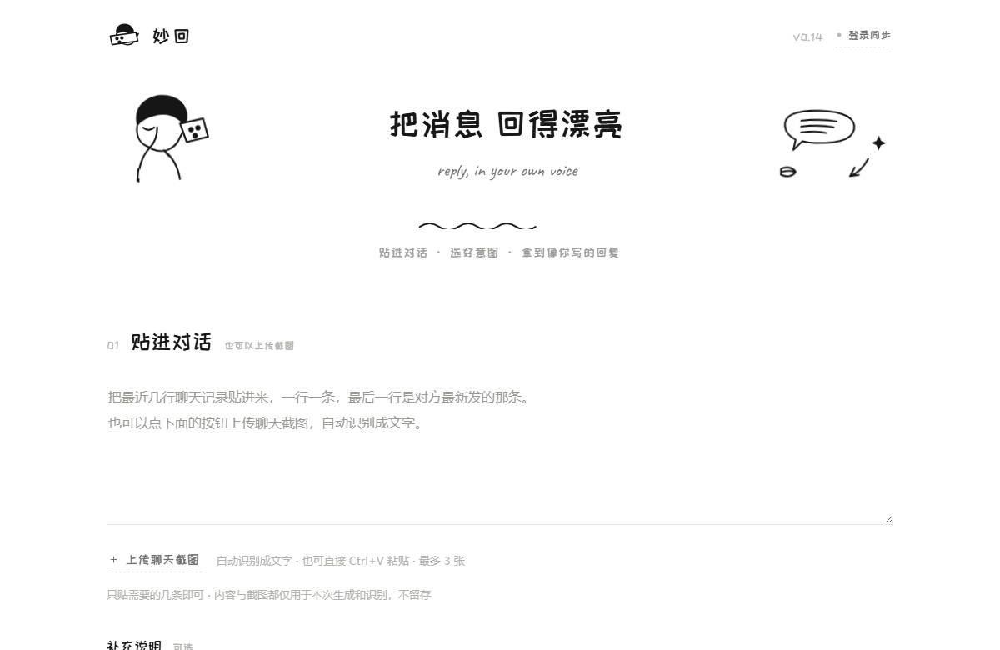
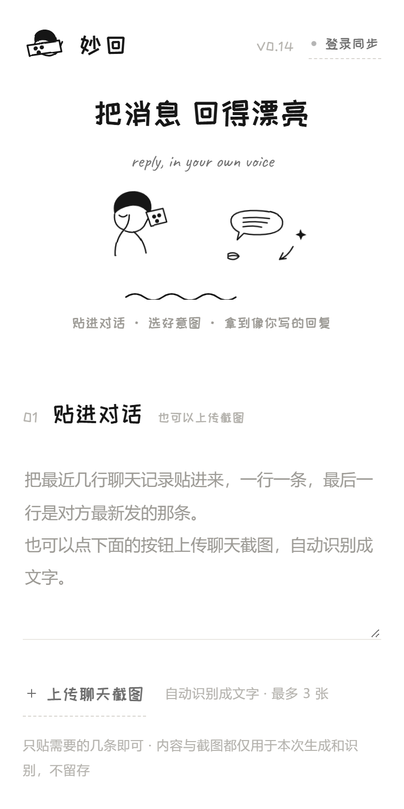

# 妙回 · 把任何一条消息，回得漂亮

> 收到一条不知道怎么回的消息时，**卡住的不是措辞，是意图**——想不清楚"我回这句想达到什么效果"。
> 妙回把这一步显式化：贴进聊天记录 → 选你要的效果 → 拿到 3 条"像你自己说出来"的候选回复。

**在线使用：<https://miaohui-reply.app.workbuddy.host/>**

手机端可「添加到主屏幕」，之后从桌面图标启动，以独立应用形态使用。

<p align="center">
  
  &nbsp;&nbsp;
  
</p>

---

## 一句话说清它和别的"AI 代写"有什么不同

市面上同类工具大多按**场景**组织（"回复老板""拒绝邀约""挽回前任"…），场景是无限集，穷举一定漏。

妙回按**意图**组织，只有 10 个：答应并推进 / 答应但争取条件 / 委婉拒绝 / 拖延一下 / 接住话头不冷场 / 表达关心走心 / 道歉认错 / 催促提醒 / 幽默化解 / 砍价谈判。

> 社交意图是有限集，场景是无限集。
> 这是整个产品的原点，也是第一版需求文档里的第一句话。

**换来的效果**：用户不是在"找模板"，而是在回答一个关于自己的问题——"这条消息，我想达到什么目的"。

## 核心功能

| 功能 | 为什么这么设计 |
|---|---|
| **意图选择**（10 个） | 把"想达到什么效果"从用户脑子里挖出来，显式化成一个必选项 |
| **对方身份**（12 种 + 自定义） | 同一句"不行"，对朋友和对领导是两种分寸。身份决定语气的安全边界 |
| **风格校准 + 风格档案** | 贴 3–10 条自己平时发的话，模型照你的句长 / 语气词 / emoji 习惯来写。**可存成具名档案复用**（"对朋友""对领导"），不用每次重贴 |
| **跨设备同步** | 风格档案是用户投入时间攒下的资产。登录后同步到云端，换手机也在 |
| **聊天截图识别** | 真实场景里没人愿意为了用工具手动把聊天记录打一遍字。上传截图 / 直接 Ctrl+V 粘贴 → 自动识别成带说话人归属的文字 |
| **一键清空** | 回下一条时不用逐个模块删。**但只清"这一条消息"，保留"你这个人的资产"**（风格样本与档案留着）——一次性输入和用户资产必须分开对待 |
| **反馈闭环** | 每条候选可标"能用 / 太假"，点"太假"就地填原因。生成质量靠这个持续收样本 |

## 技术实现

单页应用，**一个 HTML 文件**（`index.html`，约 99 KB）承载全部前端；后端能力全部通过平台的免密钥云服务接入，页面内**不含任何模型 API Key**。

```
┌───────────────────────────────────────────────┐
│  index.html（单文件前端：HTML + CSS + 内联 JS）│
└───────────────┬───────────────────────────────┘
                │  x-wb-webapp-access-key（公开的客户端标识，非 Cookie）
                ▼
┌───────────────────────────────────────────────┐
│  云服务（平台提供）                            │
│  ├─ 模型网关  /.cloud/llm/chat/completions     │
│  ├─ 邮箱认证  注册 / 密码登录 / 验证码 / 改密  │
│  └─ 云数据库  风格档案表（行级隔离）           │
└───────────────────────────────────────────────┘
```

几个值得说的技术判断：

- **截图识别走多模态直读，不引 OCR 引擎。** 截图是"版面简单、量小、一次性"的输入，让模型直接看图并按业务规则（判断气泡左右 → 加上"我 / 对方"前缀、忽略状态栏）输出结构化文本，比"OCR + 后处理规则"链路更短、维护成本更低。
- **隐私边界放在数据库层，不放在前端。** 档案表用 `owner_id DEFAULT auth.uid()` + 行级策略 `USING (owner_id = auth.uid())`，前端代码里**没有任何一处传 `owner_id`**，也拿不到别人的行。未登录时该表对它完全不可见（读 0 行、写被拒，已实测）。
- **登录是增强，不是门槛。** 不登录照样完整可用（档案存本机 localStorage）；登录后才升级为跨设备。登录时以档案名为主键做一次双向合并，同名取 `updatedAt` 较新的一份。
- **同步永远不能让用户的操作失败。** 云端同步失败时档案依旧写在本机，只是提示"下次登录会自动补上"。
- **"没有埋点"也是一种产品缺陷。** "生成要等两分钟"这件事，最初只能靠使用者口头反馈才知道。所以后来加了一张**只写不读的匿名事件表**（事件类型 / 意图 / 模型 / 耗时 / 成败 / 时间）：不记聊天原文、不记邮箱手机号、不记 IP，也**没有任何跨天能认出同一个人的标识**。前端只有 `INSERT` 权限，读回被数据库拒绝（42501，已实测）——**使用数据只有作者能看，访客一行都拿不走**。换来的能力是：有人来过、生成成不成功、等了多久、哪些意图最常用、报什么错，一目了然。隐私承诺和可观测性不是二选一，关键是**只记"发生了什么"，不记"说了什么"**。

## 质量保障：不靠"我测过了"这句话

这个项目里没有一句"功能正常"是靠人工点一遍得出的。所有版本升级都跑同一套自动检查，**任何一项不过就不许上线**：

| 检查 | 覆盖 |
|---|---|
| **构建审计 14 项**（`scripts/build-shell.cjs`） | id 完整性(59) / 动态 class 有样式(39) / keyframes 有定义(20) / CSS 变量已声明(13) / 登录态回归护栏 / **逻辑层逐字节一致性** / file input 移动端护栏 / PWA 标签与资源 / **模型候选链与首字看门狗**（防止回退到平台默认模型）/ **旧版缓存自检文件** / **埋点隐私护栏**（聊天原文与风格样本不许进上报）/ **版面约定**（四个编号块末尾各一条波浪、长说明必须收在提示气泡里、图标必须是叹号版） |
| **桌面功能冒烟 22 例**（`scripts/smoke-v012.cjs`） | 意图 / 身份 / 档案存取删载 / 两个截图入口 / 3 条候选 + 9 个操作 / 反馈展开原因 / 一键清空二次确认且保留用户资产 / 登录四 Tab / 无障碍与隐私文案 |
| **移动端回归 17 例**（`scripts/e2e-mobile-upload.cjs`） | iPhone 仿真 + **真实触摸事件**：`touchscreen.tap` 点按钮是否真的抛出 `filechooser`、覆盖层与按钮几何是否重合、禁用态能否被绕过、热区是否 ≥ 44px |
| **模型链与兜底 22 例**（`scripts/e2e-model-chain.cjs`） | 用替身 SDK 把「模型选择」变成可复现用例：首选模型是否命中、优选模型缺席时是否会退到慢模型、首选模型不吐字时能否自动换下一个、等待期的进度提示、取消是否立刻生效、版本落后提示条与强制刷新参数 |
| **埋点 22 例**（`scripts/e2e-events.cjs`） | 用替身 SDK 断言上报了什么**以及没上报什么**：打开/生成/复制/失败是否记下、失败能否归成可统计的类别、**聊天原文与风格样本一个字都不许进上报**、字段只有白名单内的 10 个、上报自身报错甚至抛异常都不能影响生成、本地 `file://` 一律不打点 |
| **版面与提示图标 28 例**（`scripts/shot-v018.cjs`） | 跑真页面读真实计算样式：四个编号块末尾各一条波浪（含新增的那条位置是否落对）、三句长说明**真的不在页面上**、三处提示图标都贴在上一行末尾、静止时气泡全隐藏、鼠标悬停 / 键盘 Tab / 手指点按**三条通道**都能翻出、点别处与 Esc 能关、气泡不出屏且箭头始终指着图标（手机 393px 单独验一遍） |
| **生成质量盲评 50 例**（`scripts/run-eval-50.cjs` → `scripts/check-eval-rules.cjs` → `scripts/build-blind-eval.cjs` → `scripts/join-eval.cjs`） | 10 个意图各 5 条真实场景，**走真实接口**生成 150 条候选；机器先按 11 条硬规则核查（长度 / 禁用词 / 标点 / emoji / 三条策略是否重复 / 有没有编造没给过的时间价格），再把候选洗牌剥掉意图与身份，交两位独立评分者盲评。**盲评均分 4.6/5，10% 被判"需要改"** — 完整方法与逐版对比见 [`docs/eval-log.md`](docs/eval-log.md) |
| **线上一致性**（`scripts/check-live.cjs`） | 抓线上源码与本地**逐字节比对**、版本号核验、PWA 资源 HTTP 状态、`version.json` 与页面版本是否一致 |
| **线上埋点权限**（`scripts/verify-events.cjs`） | 在真实域名上用真实 SDK 打一次点：**匿名写入必须成功**（201）、**匿名读回必须被拒**（42501）——使用数据只有作者能看 |
| **端到端链路**（`e2e-cross-device` / `e2e-auth-ui` / `e2e-clear-all` / `e2e-v010-session-render`） | 跨设备同步真实闭环（自建临时邮箱走完整注册→换一个干净浏览器上下文登录→档案逐字一致）、认证四 Tab、清空范围 |
| **真实耗时实测**（`scripts/e2e-real-latency.cjs`） | 用真实接口在真实页面上走一次「贴对话 → 选意图 → 生成」，记录首个候选可见时间与总耗时（v0.15：3 条全部完成 1.5~2.1s），顺带量一次截图识别（2.5~2.6s） |

**最有价值的一条：逻辑层逐字节一致性。** 视觉改版时把"视觉层"和"逻辑层"拆成两个文件，构建时机械拼接，并断言产出的 JS 与基线**逐字节相同**（只允许版本号那一处改动，且长度相同）。于是"改版会不会把功能改掉"这个问题从"我相信没有"变成"构建脚本会告诉我答案"。

## 仓库结构

```
miaohui/
├── index.html                    # 应用本体（单文件前端，V0.17）
├── index.v0.17.logic.html        # 当前逻辑层基线（构建审计的比对基准，勿改）
├── index.v0.10.backup.html       # 历史逻辑层基线（保留用于对比）
├── version.json                  # 页面用它自检"我是不是旧版缓存"
├── manifest.webmanifest + pwa/   # PWA 清单与 180/192/512 图标
├── LICENSE                       # MIT
├── docs/                         # product-definition（产品定义与逐版决策）/ verification / eval-log
├── scripts/                      # 构建脚本与全部自动化检查（逐个清单见「质量保障」）
└── prototypes/                   # 设计过程留档：早期方向原型 + 提示图标候选页
```

想深看的话，`docs/product-definition.md`（为什么这么设计、逐版推翻了什么）和 `docs/eval-log.md`（实测数据）是最值得读的两份。

## 本地运行

纯静态前端，**不需要构建步骤**，直接用浏览器打开 `index.html` 即可查看界面与交互。

注意：生成 / 登录 / 云同步依赖平台的云服务接口，仅在部署域名下可用（接口有 Origin 白名单，详见 [`docs/decision-unbind-vs-platform.md`](docs/decision-unbind-vs-platform.md)）。本地打开时界面与交互完整，但调用接口会失败。

复现构建与验证（需 Node + Playwright，用本机 Edge）。每条命令查什么见上面的「质量保障」：

```bash
node scripts/build-shell.cjs          # 构建 + 14 项审计
node scripts/smoke-v012.cjs           # 桌面功能冒烟 22 例
node scripts/e2e-mobile-upload.cjs    # 移动端触摸回归 17 例
node scripts/e2e-model-chain.cjs      # 模型候选链 / 首字兜底 / 版本自检 22 例
node scripts/e2e-events.cjs           # 匿名埋点 22 例
node scripts/shot-v018.cjs            # 版面与提示图标 28 例
node scripts/verify-events.cjs        # 线上埋点权限实测（能写不能读）
node scripts/e2e-real-latency.cjs     # 真实接口端到端耗时（会真的调用模型）
node scripts/check-live.cjs           # 线上逐字节一致性
node scripts/run-eval-50.cjs          # 生成质量盲评：真实接口出 150 条候选（约 2 分钟，会自动拦截埋点写入）
```

盲评的后三步（规则核查 → 洗牌剥身份 → 合并两位评分者）见 `scripts/`，方法与数据见 [`docs/eval-log.md`](docs/eval-log.md)。

## 已知边界与取舍

- **线上地址是托管平台分配的域名，页面与云接口必须同域。** 云接口设有 Origin 白名单（放行平台域名与本机来源，拒绝其他公网域名，8 种来源的对照实测见 [`docs/decision-unbind-vs-platform.md`](docs/decision-unbind-vs-platform.md)），所以把页面迁到第三方静态托管后，生成、登录、同步这类需要云接口的功能不可用——这也是本项目目前固定在平台域名上的原因。
- **依赖的边界是清楚的**：前端全部逻辑在这一个 HTML 文件里（视觉层与逻辑层分离，可整体搬迁）；模型网关、账号体系、云档案库是平台提供的能力，共 19 个调用点（3 处模型 + 16 处登录与数据）。若要迁到自有后端，**必须换的就是那 3 处模型调用**。
- **生成质量已有大样本盲评，但只做了一轮。** 50 条真实场景 × 3 候选、两位独立评分者盲评，合并均分 4.6/5、10% 被判"需要改"；按意图看**幽默化解最好（5.0）**，**拖延一下（4.07）与道歉认错（4.2）最弱**，按身份看**对"老师"这一档最弱（3.25）**。这一轮数据直接修正了提示词（见 [`docs/eval-log.md`](docs/eval-log.md) 快照 003），但 50 条只够定位、不够下结论，还该扩样本并换一批评分者复核。
- **生成速度与生成质量目前是按"速度优先"配的**：优先用实测 1~4 秒的 flash 档模型（候选链见 `index.v0.18.logic.html` 里的 `PREFERRED_MODELS`），换来的是"打开就能用"；代价是遇到需要更绕的表达（委婉拒绝、砍价这类）时，大模型可能写得更细。取舍依据与各模型实测数据在 [`docs/eval-log.md`](docs/eval-log.md)，质量大样本评测做完后会重新校准这条链。
- **长说明的可见性降了一档**：三句原本摊在页面上的说明现在收在提示图标的气泡里（鼠标悬停 / 键盘 Tab / 点一下都能看），档案空态那句也一起收了进去。页面是干净了，但**新用户不会主动去点那个图标**——"怎么存第一个档案"的引导可见性因此降低，页面上仍留着「＋ 存为档案」按钮兜底。这一条是明确知道代价后做的，需要真实使用反馈来判要不要改回去。
- PWA 只对用户自己的设备生效（添加到主屏幕后以独立应用形态运行），**对"分享给别人、别人第一次点开"没有帮助**，那一段仍受渠道约束制约。
- 移动端回归跑的是 Chromium + iPhone 仿真 + 真实触摸事件，本机无 WebKit / 真机；"触摸能唤起选择器"是实测结论，"iOS Safari 拒绝 `display:none` 的 file input"属平台已知行为，仍需真机复点确认。

## 反馈与建议

用起来哪里别扭、哪条回复"太假"、还想要什么意图——都欢迎开 [Issue](issues) 说。

生成质量靠真实使用反馈迭代，**反馈越具体越有用**：原文是什么、你想达到什么效果、实际拿到的回复是什么。

## License

[MIT](LICENSE) — 随便用、随便改、随便商用，保留版权声明即可。

---

<sub>妙回是一个从需求定义到上线完整走完 0→1 的个人项目：需求定义 → 原型 → 工程实现 → 自动化验证 → 上线 → 渠道约束评估。逐版决策与踩坑复盘见 [`docs/product-definition.md`](docs/product-definition.md)。</sub>
